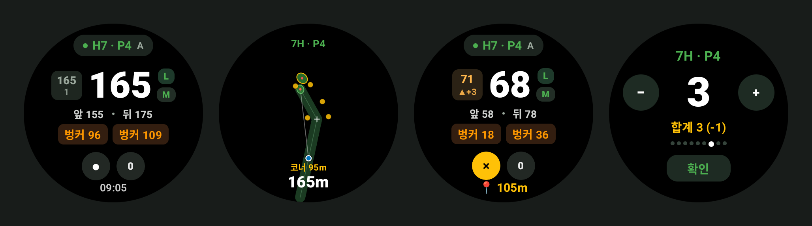
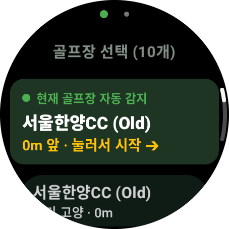
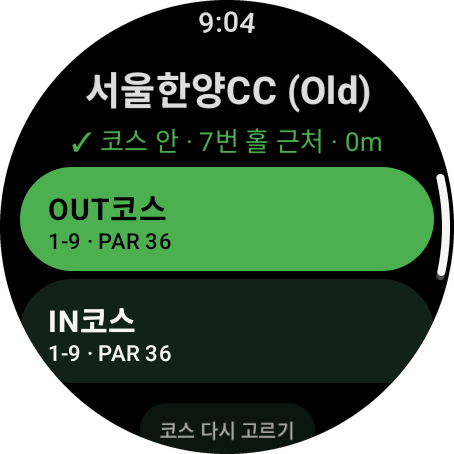
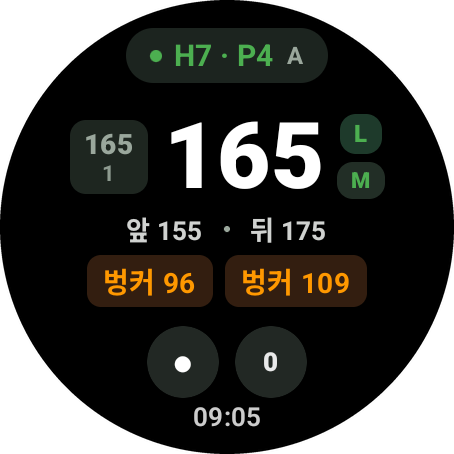
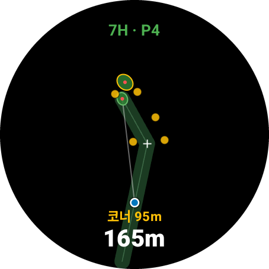
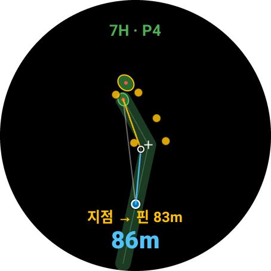
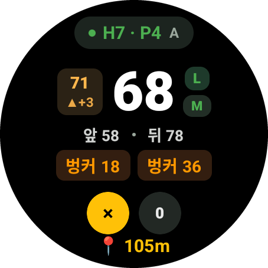
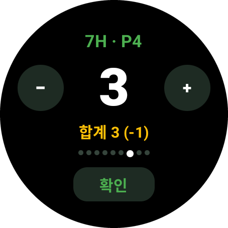
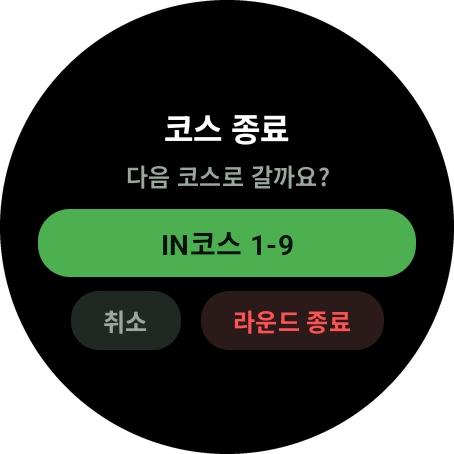

# 골프 GPS — 갤럭시 워치용 골프 거리측정 앱

폰 없이 워치만 차고 나가도 그린까지 남은 거리를 보여 주는 앱입니다.
광고, 회원가입, 인터넷 연결이 필요 없습니다.



## 이런 걸 합니다

| | |
|---|---|
| **그린 앞·중앙·뒤 거리** | 큰 숫자가 그린 중앙, 아래 줄이 앞/뒤. 벙커·해저드까지 거리도 함께 |
| **고저차 보정 거리** | 왼쪽 작은 칸: 오르막/내리막을 반영한 실제 플레이 거리와 높이 차 (▲ 오르막, ▼ 내리막) |
| **홀 지도** | 큰 숫자를 누르면 홀 모양이 나오고, 지도를 누르면 *내 위치 → 그 지점 → 핀* 거리 (레이업 계산) |
| **홀 자동 넘김** | 그린을 밟은 뒤 다음 홀 티 쪽으로 가거나 핀에서 50m 벗어나면 다음 홀로 |
| **전·후반 자동 전환** | 9번 홀을 마치면 다음에 돌 9홀 코스를 물어봄 (27홀 골프장 대응) |
| **샷 비거리** | ● 를 눌러 볼 위치를 찍고 걸어가면 방금 친 거리 표시 |
| **스코어카드** | 파에서 시작하는 +/− 입력, 파 대비 합계, 라운드 기록 저장 |
| **투그린** | 좌/우 그린 전환 (L/R) |
| **m ↔ yd** | 단위 전환 |
| **코스 측량** | 데이터 없는 골프장은 워치로 직접 걸으며 측량 (10초 가중평균) |

### 화면

| 골프장 자동 감지 | 시작 코스 확인 | 거리 | 홀 지도 |
|:-:|:-:|:-:|:-:|
|  |  |  |  |
| **레이업 거리** | **샷 비거리** | **스코어 입력** | **후반 코스 선택** |
|  |  |  |  |

## 지원 골프장 (10곳)

설악썬밸리CC · 아난티코드CC · 웰리힐리CC(North/South) · 레이크우드CC(우드/레이크) ·
렉스필드CC · 용인블루원CC · 서울한양CC(Old/New)

목록에 없는 골프장은 앱의 **새 코스 만들기**로 라운드하면서 직접 측량할 수 있습니다.

## 지원 기기

- **Wear OS 4 이상** 갤럭시 워치 (워치 4 이후 기종 중 최신 업데이트를 받은 기기)
- 실기 테스트는 갤럭시 워치 SM-L340(Wear OS 6) 한 대에서만 했습니다
- 폰 앱은 없습니다. 워치 단독으로 동작합니다

## 미리 알아 두실 것

- **거리 정확도**: 좌표는 위성사진을 보고 직접 찍은 것이라 2~5m 정도 오차가 있습니다.
  워치 GPS 오차(보통 3~5m)도 더해집니다. 공식 코스 데이터가 아닙니다.
- **핀 위치는 모릅니다**: 큰 숫자는 그린 중앙까지의 거리입니다. 앞/뒤 거리를 같이 보고 판단하세요.
- **권한**: 위치(필수), 알림(라운드 진행 표시용). 위치 정보는 워치 밖으로 나가지 않습니다.
- **배터리**: 화면을 보는 동안만 1초 간격으로 측위하고, 화면이 꺼지면 10초 간격으로 줄입니다.
  18홀 소모량은 기기와 설정에 따라 다릅니다.
- **스토어 앱이 아닙니다**: 직접 설치(사이드로드)해야 하고, 업데이트도 새 APK를 다시 설치하는 방식입니다.
  업데이트할 때는 지우지 말고 덮어 설치하면 라운드 기록이 유지됩니다.

## 설치 방법

**[APK 다운로드 (golf-gps-1.0.apk, 약 2.7MB)](https://github.com/hifeel/golf-gps-watch/releases/latest/download/golf-gps-1.0.apk)**

### 1. 워치에서 개발자 옵션과 무선 디버깅 켜기

1. 워치 **설정 → 워치 정보 → 소프트웨어 정보 → 소프트웨어 버전**을 7번 연속 누릅니다
   → "개발자 모드를 켰습니다"
2. **설정 → 개발자 옵션 → ADB 디버깅** 켜기
3. 같은 화면에서 **무선 디버깅** 켜기 (워치와 PC가 같은 Wi-Fi에 있어야 합니다)
4. 무선 디버깅 화면의 **새 기기 페어링**을 누르면 IP 주소, 포트, 6자리 코드가 나옵니다

> 워치가 폰과 블루투스로 붙어 있으면 Wi-Fi를 꺼 버리는 경우가 있습니다.
> 설치하는 동안에는 워치 Wi-Fi를 **항상 켜짐**으로 두고 화면을 켜 두세요.

### 2-A. PC로 설치 (Windows / Mac)

[Android SDK Platform-Tools](https://developer.android.com/tools/releases/platform-tools)를 받아 압축을 풉니다.
그 폴더에서 터미널(명령 프롬프트)을 열고:

```bash
adb pair 192.168.0.10:37123        # 페어링 화면의 IP:포트, 이어서 6자리 코드 입력
adb connect 192.168.0.10:41234     # 무선 디버깅 첫 화면의 IP:포트 (페어링 포트와 다릅니다)
adb install -r golf-gps-1.0.apk    # Success 가 나오면 끝
```

### 2-B. 폰만으로 설치

PC가 없으면 Play 스토어의 워치 APK 설치 앱(예: *Easy Fire Tools*, *Bugjaeger* 등)을 씁니다.
앱 안내에 따라 워치 IP·포트와 페어링 코드를 넣고 APK 파일을 고르면 됩니다.
(앱마다 화면이 다르니 각 앱 설명을 참고하세요.)

### 3. 처음 실행

1. 워치 앱 목록에서 **골프 GPS** 실행 → 위치 권한 **앱 사용 중에만 허용**
2. 골프장에 도착하면 맨 위에 **현재 골프장 자동 감지**가 뜹니다 → 누르기
3. 시작할 9홀 코스를 고르면 라운드가 시작됩니다

설치가 끝나면 개발자 옵션의 무선 디버깅은 다시 꺼 두셔도 됩니다 (배터리 절약).

## 문제 해결

| 증상 | 해결 |
|---|---|
| `INSTALL_FAILED_UPDATE_INCOMPATIBLE` | 서명이 다른 이전 버전이 깔려 있습니다. 워치에서 앱을 지우고 다시 설치 (기록은 지워집니다) |
| `adb connect` 가 안 됨 | 워치 Wi-Fi가 꺼졌거나 화면이 꺼졌습니다. 무선 디버깅을 껐다 켜면 포트가 바뀝니다 |
| 거리가 `---` | 하늘이 트인 곳에서 잠시 기다리세요. 실내에서는 GPS가 잡히지 않습니다 |
| 거리 대신 "미측량" | 그 홀의 좌표가 없습니다. 측량 모드로 채울 수 있습니다 |
